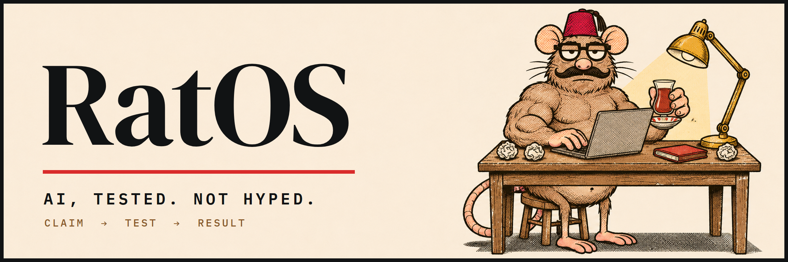

[ozanosio.com](https://ozanosio.com) &nbsp;/&nbsp; [Get in touch](mailto:ozan45emr@gmail.com)

I'm **Ozan**. **RatOS** is where I put AI to work on real tasks and write down what actually happened.

Most AI content sells a promise. I take the claim, run it, and show the result — even when the result is boring. Videos are in Turkish; the code and notes live here.

## How it works

<table>
<tr>
<td width="50%" valign="top">
<b>01 / WHAT AI IS</b>
<h3>How it works, why it fails</h3>
What a model actually does, where it guesses, and what it can't know. No magic, no doom.
</td>
<td width="50%" valign="top">
<b>02 / HOW TO USE IT</b>
<h3>Shown on real work</h3>
Agents, memory, reviews and automation — on projects that ship, not on a demo built for the camera.
</td>
</tr>
<tr>
<td width="50%" valign="top">
<b>03 / AGAINST AI SLOP</b>
<h3>Claim → test → result</h3>
A viral claim gets tried. If it holds, I say so. If it doesn't, the receipts are on screen.
</td>
<td width="50%" valign="top">
<b>04 / THE RULE</b>
<h3>The claim, not the person</h3>
No names, no channels, no faces. Disagreement without proof doesn't get published.
</td>
</tr>
</table>

## On the workbench: Echo

**A second brain that remembers.**

Echo runs on Obsidian and Claude Code. It carries decisions, rules and open threads from one session to the next, so work doesn't restart from zero every morning. Every rule in it came from a mistake that happened once.

**In daily use.** The vault is private for now.

## Built with it

| Project | What to look for |
|---|---|
| [FitTrack](https://github.com/Golemozan/FitTrack) | Live in production. An AI coach that knows Turkish cuisine, on web and Telegram. |
| [RugRadar](https://github.com/Golemozan/rugradar) | Solana memecoin scanner. A Redis job queue made it 5.5× faster. |
| [vet-clinic](https://github.com/Golemozan/vet-clinic) | Clinic management SaaS. [Live demo →](https://www.ozanosio.com/vet-clinic/) |
| [mojiblame](https://github.com/Golemozan/mojiblame) | A CLI that finds where broken text encoding came from. |

Also: [TradingJournal](https://github.com/Golemozan/TradingJournal) · [LinkSnap](https://github.com/Golemozan/LinkSnap) · [gayrimenkul-crm](https://github.com/Golemozan/gayrimenkul-crm)

---

**Claim. Test. Result.**

For collaborations: [ozan45emr@gmail.com](mailto:ozan45emr@gmail.com)

